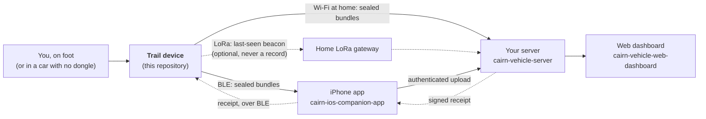

<!-- cairn-nav:start -->

<b>Cairn is a family of seven repositories.</b> Each builds, tests and releases on its own; they agree through the shared <a href="https://github.com/ParkWardRR/cairn-driving-log-selfhosted/tree/main/contracts">contracts</a>, and they share one <a href="https://github.com/ParkWardRR/cairn-driving-log-selfhosted/blob/main/ROADMAP.md">roadmap</a>.

| Part | Repository | What it does | Stack | Docs | Issues | CI |
|---|---|---|---|---|---|---|
| Front door | [cairn-driving-log-selfhosted](https://github.com/ParkWardRR/cairn-driving-log-selfhosted) | Docs, roadmap, shared protocol contracts | Markdown · Go tools | [docs](https://github.com/ParkWardRR/cairn-driving-log-selfhosted/tree/main/docs) | [issues](https://github.com/ParkWardRR/cairn-driving-log-selfhosted/issues) | [CI](https://github.com/ParkWardRR/cairn-driving-log-selfhosted/actions) |
| Dongle | [cairn-esp32-device-firmware](https://github.com/ParkWardRR/cairn-esp32-device-firmware) | In-car recorder: OBD-II, GNSS, IMU to encrypted SD bundles | C++ · C · Rust | [docs](https://github.com/ParkWardRR/cairn-esp32-device-firmware/tree/main/docs) | [issues](https://github.com/ParkWardRR/cairn-esp32-device-firmware/issues) | [CI](https://github.com/ParkWardRR/cairn-esp32-device-firmware/actions) |
| Trail device | **[cairn-trail-device-firmware](https://github.com/ParkWardRR/cairn-trail-device-firmware)** ◀ you are here | Handheld recorder for hiking, walking and driving without the dongle | Rust · esp-hal · Embassy | [docs](https://github.com/ParkWardRR/cairn-trail-device-firmware/tree/main/docs) | [issues](https://github.com/ParkWardRR/cairn-trail-device-firmware/issues) | [CI](https://github.com/ParkWardRR/cairn-trail-device-firmware/actions) |
| Phone | [cairn-ios-companion-app](https://github.com/ParkWardRR/cairn-ios-companion-app) | BLE relay, GPS assist, server client | Swift · SwiftUI | [docs](https://github.com/ParkWardRR/cairn-ios-companion-app/tree/main/docs) | [issues](https://github.com/ParkWardRR/cairn-ios-companion-app/issues) | [CI](https://github.com/ParkWardRR/cairn-ios-companion-app/actions) |
| Server | [cairn-vehicle-server](https://github.com/ParkWardRR/cairn-vehicle-server) | Verifies, decrypts, stores; serves app and dashboard | Go | [docs](https://github.com/ParkWardRR/cairn-vehicle-server/tree/main/docs) | [issues](https://github.com/ParkWardRR/cairn-vehicle-server/issues) | [CI](https://github.com/ParkWardRR/cairn-vehicle-server/actions) |
| Dashboard | [cairn-vehicle-web-dashboard](https://github.com/ParkWardRR/cairn-vehicle-web-dashboard) | Browser UI: trips, places, engine, health | Nuxt · TypeScript | [docs](https://github.com/ParkWardRR/cairn-vehicle-web-dashboard/tree/main/docs) | [issues](https://github.com/ParkWardRR/cairn-vehicle-web-dashboard/issues) | [CI](https://github.com/ParkWardRR/cairn-vehicle-web-dashboard/actions) |
| Modules | [cairn-modules](https://github.com/ParkWardRR/cairn-modules) | Interpretation, separated from the logging core: one package per module | YAML · Rust | [readme](https://github.com/ParkWardRR/cairn-modules#readme) | [issues](https://github.com/ParkWardRR/cairn-modules/issues) | [CI](https://github.com/ParkWardRR/cairn-modules/actions) |

Shared: [Roadmap](https://github.com/ParkWardRR/cairn-driving-log-selfhosted/blob/main/ROADMAP.md) · [Install](https://github.com/ParkWardRR/cairn-driving-log-selfhosted/blob/main/INSTALL.md) · [Architecture](https://github.com/ParkWardRR/cairn-driving-log-selfhosted/blob/main/docs/architecture.md) · [Threat model](https://github.com/ParkWardRR/cairn-driving-log-selfhosted/blob/main/docs/threat-model.md) · [Trust model](https://github.com/ParkWardRR/cairn-driving-log-selfhosted/blob/main/docs/trust-model-v3.md) · [Contracts](https://github.com/ParkWardRR/cairn-driving-log-selfhosted/tree/main/contracts) · [Archive of the original monorepo](https://github.com/ParkWardRR/cairn-original-monorepo-archive)
<!-- cairn-nav:end -->
<h1 align="center">Cairn trail device firmware</h1>

<strong>Firmware for a pocket-sized Cairn recorder you carry on a hike or a walk, or bring along in a car that has no dongle. It records where you went, how high you climbed and how fast you moved into the same encrypted, tamper-evident bundles the car's dongle writes, and hands them to your own server. It never deletes a recording until your server has signed for exactly that recording.</strong>

  
  
  
  
  

---

> **Status, 2026-10-25: Designed. Nothing is built and nothing has run.** This repository holds
> the plan for the device, its hardware notes and its contract pin. There is no firmware yet, and
> the board has not been powered on for Cairn. Everything below that describes behaviour is the
> design, in the project's own words for it: *Designed* means a plan exists, not that anything
> works.

This repository is one of seven that make up [Cairn](https://github.com/ParkWardRR/cairn-driving-log-selfhosted),
a self-hosted driving log that is growing a second device. The car has a dongle on its OBD-II
port. This is the other one — the one you carry.

The rule is the dongle's rule: the carrier moves ciphertext it cannot read, and the device frees
its card only on a receipt it has verified itself.

**Contents:**
[What it is](#what-the-trail-device-is-and-is-not) ·
[Hardware](#hardware) ·
[How it fits Cairn](#how-it-fits-cairn) ·
[Firmware stack](#firmware-stack-rust-esp-hal-embassy) ·
[Activities](#activities-hike-walk-drive) ·
[What it records](#what-it-records) ·
[Display and buttons](#display-and-buttons) ·
[Power](#power) ·
[Getting recordings home](#getting-recordings-home) ·
[LoRa](#lora) ·
[Security](#security-posture) ·
[Contracts](#contracts) ·
[Where it is going](#where-it-is-going) ·
[Layout](#repository-layout) ·
[Contributing](#contributing)

## What the trail device is, and is not

**It is** a battery-powered GNSS recorder with a barometer, an accelerometer and gyroscope, a
compass, a real-time clock, a small screen and two buttons. It writes Cairn `format/v3` bundles —
every frame encrypted, every bundle signed — so the server, the dashboard and the phone treat a
hike exactly as they treat a drive, apart from what it means.

**It is not:**

- **an OBD-II logger.** It has no vehicle bus. In a car it records a GNSS and motion track and
  nothing about the engine. If the car's dongle recorded the same window, the server lays the two
  side by side; the two devices never talk to each other.
- **an emergency device.** The LoRa radio can make it *findable*, best effort. It is not a
  personal locator beacon and has no satellite link, and nothing here will claim it can summon
  help.
- **Meshtastic.** The board ships as a Meshtastic node; this firmware replaces that. Whether it
  will ever speak the Meshtastic protocol is an open decision (see [LoRa](#lora)).

## Hardware

**LILYGO T-Beam Supreme**, 915 MHz, with the u-blox MAX-M10S GNSS and the 1.3" SH1106 OLED. The
full pin map, I²C addresses and the things that shape the firmware are in
[docs/hardware.md](docs/hardware.md). All of it is vendor documentation until bring-up reads each
part off the real unit.

| Part | Chip | Used for |
|---|---|---|
| MCU | ESP32-S3FN8, 8 MB flash, 8 MB PSRAM | Everything; Wi-Fi and BLE 5 |
| GNSS | u-blox MAX-M10S, four constellations | Position, read as UBX-NAV-PVT so accuracy is the receiver's own estimate |
| LoRa | Semtech SX1262, 915 MHz | Optional *last seen* beacons only |
| Display | SH1106 OLED, 128×64 | Status, the activity, a bearing back to the start |
| IMU | QMI8658, 6-axis | Steps, cadence, motion, wake-on-motion |
| Compass | QMC6310 / QMC6309 | Heading when standing still |
| Barometer | Bosch BME280 | Elevation change, temperature, humidity |
| RTC | NXP PCF8563 | Time before the first fix — the first Cairn device with one |
| PMU | X-Powers AXP2101 | Rails, charging, fuel gauge, the power key |
| Storage | microSD | A cache of ciphertext |
| Battery | one 18650 | — |

## How it fits Cairn

Most of what makes the dongle trustworthy carries over unchanged, because none of it was about
cars:

| From the dongle | Here |
|---|---|
| `format/v3` sealing: AEAD per frame, CRC chain, Merkle root, signed manifest | The same format, byte for byte, passing the same 33 vectors on this silicon |
| `K_root` in NVS, escrowed through `enrolment/v1` | The same enrolment blob and USB console protocol |
| The device counter, reserved before the first segment exists | The same rule |
| Deletion only on a verified, signed receipt | The same rule — it is [invariant 2](https://github.com/ParkWardRR/cairn-driving-log-selfhosted/blob/main/ROADMAP.md#guiding-invariants) |
| `ble/v1` bundle offload through the phone | The same protocol; the phone does not care what produced the bundle |
| The GNSS plausibility gate | Re-tuned for walking speeds, with the pedometer as the cross-check OBD speed was in the car |
| Signed OTA with a separate update key | The same design on the S3's A/B partitions |

**What carries over is design, contracts and vectors — not the dongle's C.** This firmware is
Rust. The one piece of code it shares is `format/v3`: the dongle repository's emulator is already
a Rust implementation of it, and it is extracted into a `no_std` crate, `cairn-format`, that the
emulator and this firmware both depend on, pinned by git revision.

**Who carries it.** Every v3 bundle names the vehicle its device is assigned to, and intake checks
that before it decrypts anything. The planned answer is a *carrier*: the server's vehicle registry
gains a `kind` (`car` or `person`), and this device is assigned to a person. No format change; a
hike stays apart from a drive because its carrier has a different id. Driving with the trail
device does not reassign it — the activity is classified as a drive, and linked to the car's own
trip where one overlaps.

The full design, with its alternatives and open decisions, is
[docs/trail-device-plan.md](https://github.com/ParkWardRR/cairn-driving-log-selfhosted/blob/main/docs/trail-device-plan.md)
in the front door.

## Firmware stack: Rust, esp-hal, Embassy

The owner's choice (2026-10-25). The full crate map and its reasoning are in
[§3.1 of the plan](https://github.com/ParkWardRR/cairn-driving-log-selfhosted/blob/main/docs/trail-device-plan.md#31-the-firmware-stack-rust-esp-hal-embassy).

| Layer | Crates |
|---|---|
| HAL and runtime | `esp-hal` 1.x; Embassy (`embassy-executor`, `embassy-time`, `embassy-sync`) through `esp-rtos`; `esp-alloc` on the PSRAM |
| Radio | `esp-radio` for Wi-Fi and the BLE controller; `trouble-host` for the BLE host and the `ble/v1` GATT service; `embassy-net` for `uplink/v1`; `lora-phy` for the SX1262 |
| Storage | the card through `embedded-fatfs` or `embedded-sdmmc` (chosen in T2 — sealing needs an atomic rename); keys and the device counter in flash through `esp-storage` + `sequential-storage`; partitions and OTA through `esp-bootloader-esp-idf` |
| Sensors and display | `ublox` (UBX-NAV-PVT), `bme280`, `sh1106` + `embedded-graphics`; **drivers written here** for the AXP2101, QMI8658, QMC6310/6309 and PCF8563 |
| Bundles and crypto | `cairn-format` (shared with the emulator); RustCrypto `chacha20poly1305`, `hkdf`, `sha2`, `ed25519-dalek`, `x25519-dalek`; `esp-hal`'s TRNG |
| Logs | `defmt` over USB-Serial-JTAG |

**One task owns each bus** and reports facts over channels to **one capture controller that owns
all state** — the dongle's rule, which Embassy makes the natural shape. The SD card and the IMU
share an SPI bus behind `embassy-embedded-hal`'s shared-bus mutex, so the dongle's unlocked-bus
failure cannot be written by accident.

The S3 is Xtensa, so the toolchain is Espressif's fork, installed with
[`espup`](https://github.com/esp-rs/espup); [`espflash`](https://github.com/esp-rs/espflash)
flashes and monitors. The logic crates are `no_std` and test on stable Rust on the host, where the
contract vectors are replayed.

## Activities: hike, walk, drive

An **activity** is this device's trip: one outing, start to finish, even across a battery swap.
With no ignition to watch, the evidence is movement:

| | Evidence |
|---|---|
| **Start** | A sustained step cadence; or GNSS speed above walking pace with the IMU agreeing; or a button |
| **Pause** | Stillness — no steps, the IMU at rest, GNSS speed in its noise. Lunch at the summit is part of the hike |
| **Stop** | Stillness for longer than the stop dwell, or a button. A pre-roll ring keeps the first minute of movement |

The device writes its own guess at the mode — `walk`, `hike`, `run`, `drive` — with a confidence,
and the **server decides** from the whole track: cadence, speed, climb rate, and whether the car's
dongle was recording at the same time. A correction is an annotation, never an edit to a sealed
bundle.

| Mode | GNSS | Why |
|---|---|---|
| On foot | 1 Hz | A point every 1–1.5 m at walking pace — enough to keep a switchback |
| Drive | 5 Hz | The dongle's density |
| Endurance | 0.1 Hz, receiver power-save | Multi-day trips; an honest gap beats an invented line |

## What it records

Everything the dongle records that applies, plus what a body-worn device can add. The new record
types are **designed and not yet in the contract**; they are additive, so a decoder that predates
them skips them and still reads the track.

| Record | Status |
|---|---|
| `GNSS_SAMPLE`, `GNSS_GAP`, `IMU_SUMMARY`, `DEVICE_HEALTH`, `TRIP_EVENT`, `STATE_TRANSITION`, `TIME_OBSERVATION`, `POLICY_SNAPSHOT` | In `format/v3` today |
| `TIME_OBSERVATION` from the **RTC** (source 4) | Reserved in `format/v3` for exactly this hardware; to be defined |
| `BARO_SAMPLE` — pressure, temperature, humidity | Designed |
| `POWER_STATUS` — cell voltage, charge, charging, USB present | Designed |
| `ACTIVITY_SUMMARY` — steps, cadence, the device's mode guess, magnetic heading | Designed |
| `TRIP_EVENT` `MARK`, `MODE_CHANGE`, `USER_START`, `USER_STOP` | Designed |
| Manifest `device_class` = `lilygo-tbeam-supreme` | Designed |

Elevation is **raw on the device and fused on the server**: GNSS altitude is noisy by tens of
metres, barometric pressure is smooth but drifts with the weather, and only together do they give
a climb you can defend.

## Display and buttons

Off unless woken. Four screens — **Status** (recording, and how the device knows; fix; battery;
bundles awaiting a receipt), **Activity** (time, distance, climb, pace), **Back** (bearing and
distance to where you started) and **Clock** (time and which source set it).

| Input | Action |
|---|---|
| BOOT, short | Next screen |
| BOOT, hold 2 s | **Mark** this spot |
| PWR, short | Wake the display |
| BOOT + PWR, hold | Start or stop an activity by hand |
| PWR, long | Power off — the device seals its open bundle first when the PMU warns it |

The recording indicator only claims recording on fresh evidence, and says so when it cannot
confirm.

## Power

**Targets, unmeasured:** at least **24 hours** of 1 Hz on-foot recording on one 3000 mAh 18650 with
the screen mostly off, and at least **5 days** in endurance mode. The real numbers will come from a
meter, not a datasheet.

A low cell **seals, it does not truncate**: at a PMU threshold the open bundle is sealed and
recording stops, with enough left for the clock and a later boot. The IMU's interrupt line cannot
wake the S3 from deep sleep (it is not on an RTC-capable pin), so the design light-sleeps while an
activity could start and deep-sleeps on a timer or a button when it has been still for hours — to
be confirmed on the board.

## Getting recordings home

1. **BLE through the iPhone app**, by the same `ble/v1` offload the dongle uses. Until the app
   carries bundles, `cmd/cairn-phone` on a Mac does.
2. **Wi-Fi at home**, by `uplink/v1` — this device has no legacy listener to migrate from, so it
   is meant to be the first to implement the device-signed uplink.
3. **The SD card**, read on a Mac and pushed with the server's `cairn-push`. The path that always
   works.

There is no cellular modem on this board.

## LoRa

Optional, **off by default**, and shown on the screen when on. A small sealed beacon lets someone
at home see where the device was last heard. A beacon is **provisional**: it is never stored as a
position, never joined into an activity, and can never authorise deleting anything. The wire
format is reserved as
[`beacon/v1`](https://github.com/ParkWardRR/cairn-driving-log-selfhosted/tree/main/contracts/beacon/v1)
and will not be designed until the threat model covers broadcasting a location. US 915 MHz ISM
and FCC Part 15 limits set the beacon interval. Speaking the Meshtastic protocol is an open
decision: Meshtastic and its protocol definitions are GPLv3, and this project is Blue Oak.

## Security posture

Inherited: every frame AEAD-encrypted, so the card is a cache of ciphertext; the device root
escrowed at enrolment; deletion only on a receipt verified on the device; signed OTA.

Better than the dongle: **the ESP32-S3 supports Secure Boot V2 and flash encryption**, which the
dongle's rev v1.0 chip cannot. This is the first Cairn hardware on which the front door's chip
hardening phase can run — on a sacrificial second unit first, never straight onto the one in use.

Worse than the dongle: **it is carried, so it will be lost.** Revoking a lost device has to work
before the device is used for real.

## Contracts

Pinned in [`contracts.lock`](contracts.lock) to **`contracts-v0.8.0`** (`412a5ee`):

| Protocol | Use |
|---|---|
| `format/v3` | Writes bundles |
| `enrolment/v1` | Produces the sealed enrolment blob, speaks the USB console protocol |
| `ble/v1` | Serves bundle offload and device info |
| `uplink/v1` | Wi-Fi upload, once built |

The additions this device needs — the record types above, a device-class record in `ble/v1`
device info, the carrier `kind`, activity views in the store — are listed in
[§11 of the plan](https://github.com/ParkWardRR/cairn-driving-log-selfhosted/blob/main/docs/trail-device-plan.md#11-contract-changes)
and land in the front door through the normal contract process before any code here depends on
them.

## Where it is going

The schedule lives in the one Cairn roadmap, as phases **T1–T8**:
[ROADMAP.md — the trail device](https://github.com/ParkWardRR/cairn-driving-log-selfhosted/blob/main/ROADMAP.md#t1t8--the-trail-device--designed).
In short: bring-up, then the capture core on the S3, then enrolment and the first hike on the
dashboard, then activities, battery life, the ways home, LoRa, and chip hardening. The next step is
**T1, bring-up**: power the board, enable the PMU rails, and read every part off the real unit
into [docs/hardware.md](docs/hardware.md).

## Repository layout

| Path | What |
|---|---|
| [`docs/hardware.md`](docs/hardware.md) | The board: parts, pins, I²C addresses, what shapes the firmware, and what has been read off a real unit |
| [`contracts.lock`](contracts.lock) | The contract release this repository is built against |
| [`LICENSE`](LICENSE) | Blue Oak Model License 1.0.0 |

The firmware tree arrives with T1 and T2: a Cargo workspace with the firmware binary (Xtensa,
`esp-hal` + Embassy), the board's drivers, the host-testable logic crates, a `rust-toolchain.toml`
naming the `esp` channel, `.cargo/config.toml` for `espflash`, and `cairn-format` taken by git
revision from the dongle repository.

## Contributing

- Commit as the project's configured identity; the global identity guard blocks anything else.
- A change that needs a contract change starts in the
  [front door](https://github.com/ParkWardRR/cairn-driving-log-selfhosted/tree/main/contracts),
  not here.
- A fix to `cairn-format` goes to the emulator workspace in the dongle's repository first, and
  arrives here by bumping the revision.
- Pin exact versions of the `esp-*` crates in `Cargo.lock`; `esp-radio` is `unstable` and changes
  between minor releases.
- **Do not add a roadmap here.** Cairn keeps exactly one, in the front door. This README says what
  the device is and what it has running; the plan and the ordering live in
  [ROADMAP.md](https://github.com/ParkWardRR/cairn-driving-log-selfhosted/blob/main/ROADMAP.md).

## License

[Blue Oak Model License 1.0.0](LICENSE).
